<div dir="rtl" align="center">

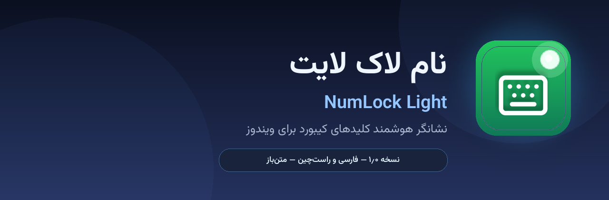

# نام‌لاک لایت | NumLock Light

**نشانگر هوشمند کلیدهای کیبورد برای ویندوز — فارسی، راست‌چین، سبک و زیبا**

نسخه ۱٫۱٫۰ — نسخه نهایی: استارت سریع، صداهای کارکردی، نصاب خودکار

[](https://github.com/100ri-ir/NumLockLight)
[](LICENSE)
[](https://python.org)
[](https://github.com/100ri-ir/NumLockLight/releases)

[🇬🇧 English](#-english) | [🇮🇷 فارسی](#-فارسی)

</div>

---

## 🇬🇧 English

**NumLock Light** is a tiny, fast, fully Persian (RTL) tray indicator for the
toggle keys of your keyboard: **Num Lock, Caps Lock, Scroll Lock and Insert**.
Version 1.1.0 is the final release: a much faster startup (the tray appears
right away — the heavy GUI imports were moved off the startup path), a fixed
sound engine (all effects play again on Python 3.13+), and a self-healing
installer builder (auto-installs Inno Setup, falls back to a built-in
Windows SFX engine).

### ✨ Features

- 🎯 **4 keys monitored** — Num Lock, Caps Lock, Scroll Lock, Insert; each can be enabled/disabled with its own colors
- 🟢 **Green = ON, Red = OFF** — big clickable key tiles at the top of the window toggle the keys for you
- ⚡ **100% accurate & instant** — a low-level keyboard hook (WH_KEYBOARD_LL) catches every toggle, from any keyboard, on-screen keyboard, remote desktop or script
- 🎨 **6 tray icon styles** — Letter badge (default), Keycap, Classic LED, Ring, Glow orb, Modern icon — with real rendered previews and a live taskbar preview
- 🖥️ **Animated OSD** — glassy on-screen pill with fade in/out; **drag it anywhere with the mouse** to choose a custom position (multi-monitor & taskbar aware)
- 🌐 **Persian + English UI** — the layout mirrors itself perfectly (RTL ↔ LTR); only the language changes, nothing breaks
- 🔊 **Sound feedback** — 8 bundled CC0 effects, separate on/off sounds, volume control (never touches the system volume)
- 🌙 **Dark & light themes** — Vazirmatn font, Persian digits
- 🚀 **Run at Windows startup**, balloon notifications, single-instance
- 🖱️ **Toggle keys from the tray menu or the key tiles** — no need to touch the keyboard
- 🧳 **Portable & installed modes** — portable keeps settings next to the EXE; installer uses %APPDATA%
- ⚡ **Lightweight** — no background services
- 📦 One-click CI — GitHub Actions build on every tag

### 📸 Screenshots

| Settings — General | Settings — Keys |
|---|---|
| 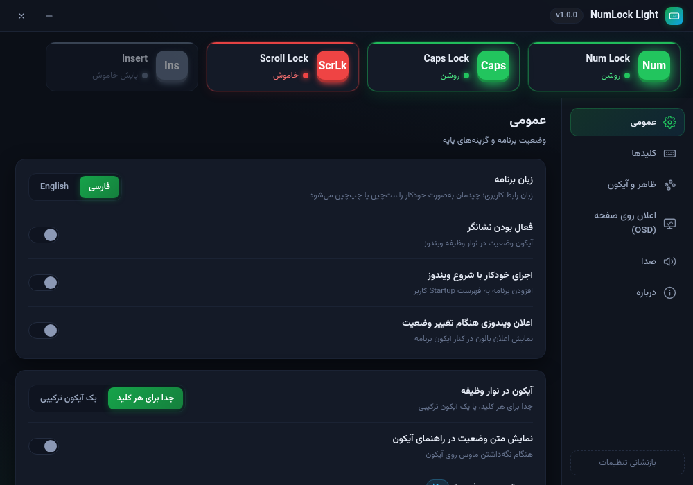 | 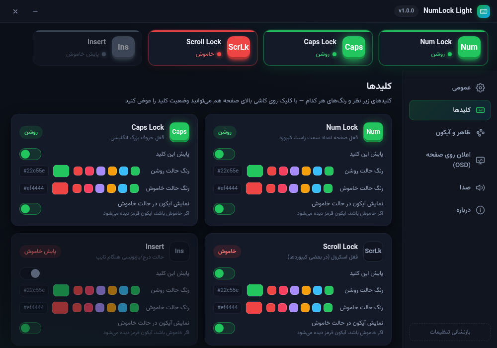 |

| Appearance & icon styles | OSD position picker |
|---|---|
| 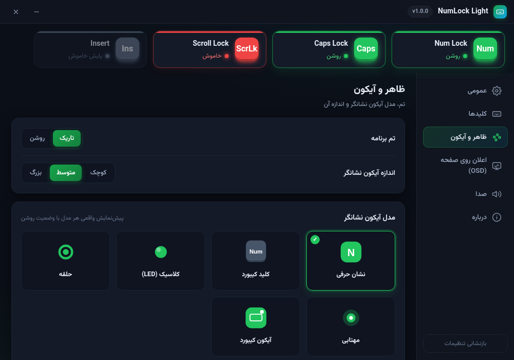 | 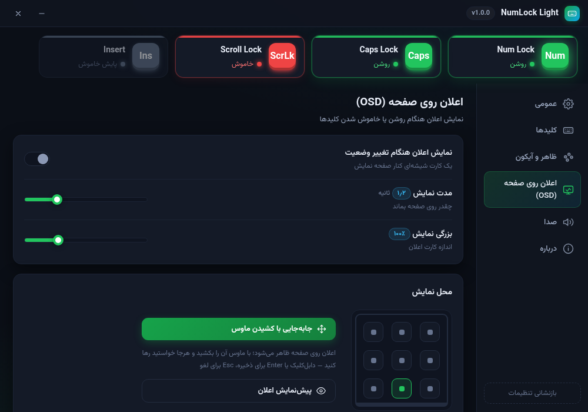 |

| Light theme | English UI |
|---|---|
| 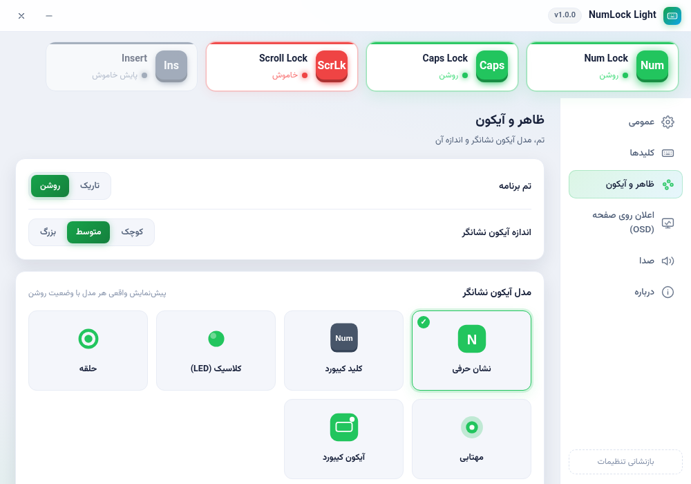 | 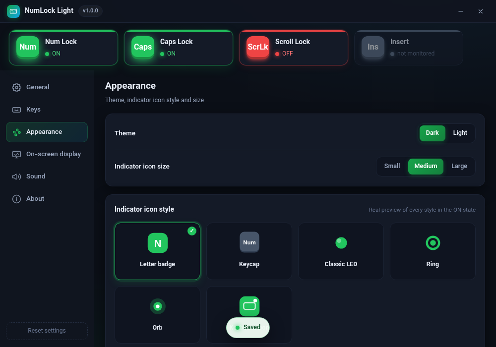 |

<details>
<summary>More screenshots</summary>

| About | OSD notification |
|---|---|
| 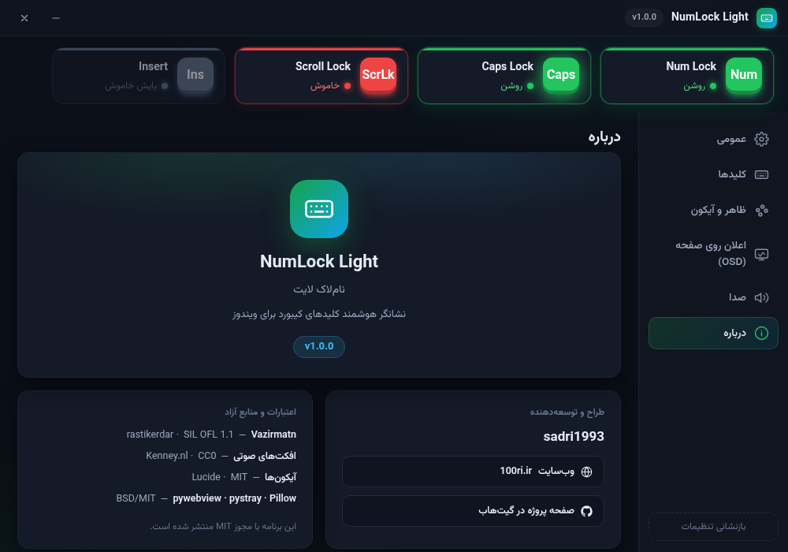 | 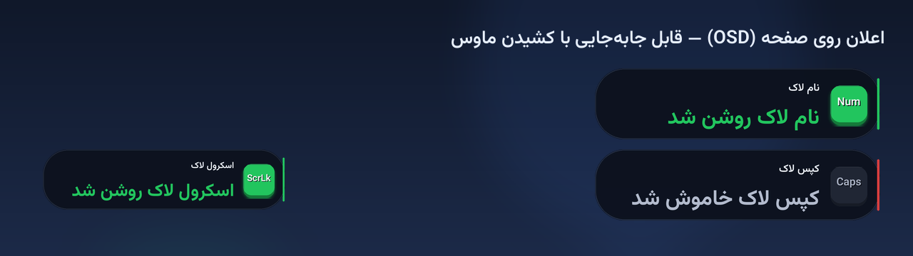 |

| Sound | Six tray icon styles |
|---|---|
| 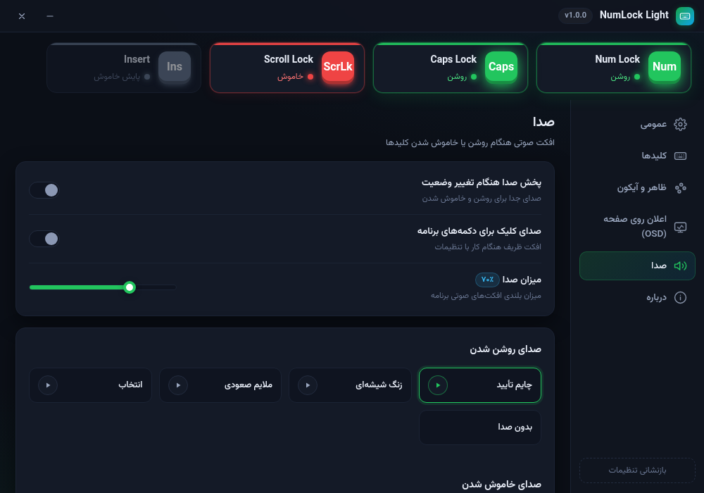 | 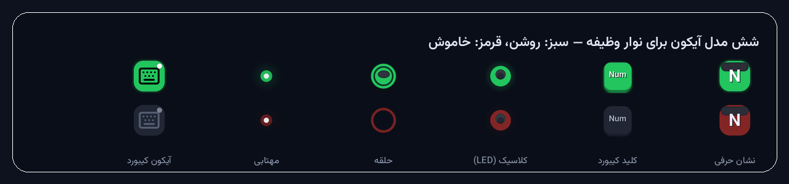 |

</details>

### 📥 Download

Grab the latest build from **[Releases](https://github.com/100ri-ir/NumLockLight/releases)**:

| File | Description |
|---|---|
| `NumLockLight-Setup-1.1.0.exe` | Installer (recommended) |
| `NumLockLight-1.1.0-Portable.zip` | Portable — extract anywhere and run |

Requires Windows 10 (1903+) or Windows 11 with the **WebView2 runtime**
(pre-installed on all updated Windows 10/11 — the app offers to install it if missing).

### 🛠️ Build from source

```bat
git clone https://github.com/100ri-ir/NumLockLight
cd NumLockLight
pip install -r requirements.txt
python run.py
```

See `build/` for the Windows packaging scripts. The supported flow is
`Build_All.bat` → PyInstaller **onedir** bundle → Inno Setup installer
(lzma2/ultra64 + solid); `Fetch_Assets.py` runs at *build* time only.
Run `NumLockLight.exe --check` for a dependency/asset self-check, and see
`NumLockLight.log` next to `settings.json` when troubleshooting.

**If the tray icon is ever unavailable** (or you turned the indicator off):
simply run `NumLockLight.exe` again — the running instance opens its
settings window, which now always works and includes a Quit button. In the
worst case (no tray icon could be created at all), the settings window
opens automatically at startup so the app is never uncontrollable.

---

## 🇮🇷 فارسی

<div dir="rtl">

**نام‌لاک لایت** نشانگری کوچک و سریع برای کلیدهای قفل کیبورد شماست:
**نام لاک، کپس لاک، اسکرول لاک و اینسرت**.
نسخهٔ ۱٫۱٫۰ نسخهٔ نهایی است: استارت بسیار سریع‌تر (آیکون‌ها بلافاصله ظاهر می‌شوند)،
موتور صدا کاملاً تعمیر شد (همهٔ افکت‌ها دوباره پخش می‌شوند) و سازندهٔ نصب
خودی‌تعمیرگر است (Inno Setup را خودش نصب می‌کند).

### ✨ امکانات

- 🎯 پایش ۴ کلید: نام لاک، کپس لاک، اسکرول لاک، اینسرت — هر کدام با رنگ و تنظیمات مستقل
- 🟢 **سبز یعنی روشن، قرمز یعنی خاموش** — کاشی‌های بزرگ بالای پنجره با کلیک، وضعیت کلید را عوض می‌کنند
- ⚡ **دقیق و لحظه‌ای** — هوک کیبورد سطح‌پایین (WH_KEYBOARD_LL) هر تغییری را از هر کیبورد، کیبورد مجازی، ریموت یا اسکریپتی می‌گیرد
- 🎨 شش مدل آیکون نشانگر — نشان حرفی (پیش‌فرض)، کلید کیبورد، LED کلاسیک، حلقه، مهتابی، آیکون مدرن — با پیش‌نمایش واقعی و پیش‌نمایش زندهٔ نوار وظیفه
- 🖥️ اعلان روی صفحه (OSD) با انیمیشن محو شدن — **با ماوس هرجا خواستید بکشید** تا محل دلخواه ذخیره شود (چند-مانیتور و نوار وظیفه را می‌شناسد)
- 🌐 فارسی + انگلیسی — چیدمان کاملاً آینه‌ای می‌شود؛ فقط زبان عوض می‌شود و هیچ‌چیز به‌هم نمی‌ریزد
- 🔊 بازخورد صوتی — ۸ افکت آزاد CC0، صدای جدا برای روشن/خاموش، کنترل میزان صدا (بدون دست‌کاری صدای سیستم)
- 🌙 تم تاریک و روشن — فونت وزیرمتن، ارقام فارسی
- 🚀 اجرای خودکار با ویندوز، اعلان بالون، تک‌نمونه (Single Instance)
- 🖱️ تغییر وضعیت کلیدها از منوی آیکون یا کاشی‌های بالای پنجره
- 🧳 نسخهٔ پرتابل و نصبی — پرتابل تنظیمات را کنار EXE نگه می‌دارد؛ نصبی در %APPDATA%
- ⚡ سبک و بدون سرویس پس‌زمینه

### 📥 دانلود

آخرین نسخه را از **[Releases](https://github.com/100ri-ir/NumLockLight/releases)** بگیرید:

| فایل | توضیح |
|---|---|
| `NumLockLight-Setup-1.1.0.exe` | نسخهٔ نصبی (پیشنهادی) |
| `NumLockLight-1.1.0-Portable.zip` | نسخهٔ پرتابل — هرجا خواستید باز کنید و اجرا |

نیازمند ویندوز ۱۰ (۱۹۰۳ به بعد) یا ویندوز ۱۱ با **WebView2**
(روی همهٔ ویندوزهای به‌روز از قبل نصب است — در صورت نبود، خود برنامه راهنمایی می‌کند).

</div>

---

<div align="center">

**طراح و توسعه‌دهنده:** sadri1993 — [100ri.ir](https://100ri.ir) — مجوز MIT

</div>
