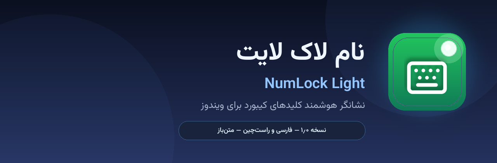

<div dir="rtl" align="center">



# نام‌لاک لایت | NumLock Light

**نشانگر هوشمند کلیدهای کیبورد برای ویندوز — فارسی، راست‌چین، سبک و زیبا**

نسخهٔ ۱٫۰٫۰

[](https://github.com/100ri-ir/NumLockLight)
[](LICENSE)
[](https://github.com/100ri-ir/NumLockLight/releases)

</div>

---

<div dir="rtl">

## معرفی

**نام‌لاک لایت** نشانگری کوچک و سریع برای کلیدهای قفل کیبورد شماست:
**نام لاک، کپس لاک، اسکرول لاک و اینسرت**. برنامه در نوار وظیفه (کنار ساعت)
می‌نشیند، لحظه‌ای که کلیدی روشن یا خاموش می‌شود رنگش عوض می‌شود، می‌تواند
اعلان متحرک روی صفحه نمایش دهد و صدای ملایمی پخش کند — همه اختیاری و از
پنجرهٔ تنظیمات مدرن قابل تنظیم.

نسخهٔ ۱٫۰٫۰ **بازطراحی کامل** است:

- پنجرهٔ تنظیمات به **رابط وب مدرن (WebView2)** با راست‌چین‌سازی بی‌نقص تبدیل شد
- تشخیص وضعیت با **هوک کیبورد سطح‌پایین** — لحظه‌ای و ۱۰۰٪ دقیق
- کاشی‌های وضعیت **سبز/قرمز** بالای پنجره که با کلیک، کلید را عوض می‌کنند
- اعلان روی صفحه (OSD) با قابلیت **جابه‌جایی با کشیدن ماوس**
- پشتیبانی هم‌زمان **فارسی و انگلیسی** با چیدمان آینه‌ای کامل

## امکانات

- 🎯 پایش ۴ کلید: نام لاک، کپس لاک، اسکرول لاک، اینسرت
- 🟢 سبز یعنی روشن، قرمز یعنی خاموش — قابل کلیک
- ⚡ تشخیص لحظه‌ای از هر منبعی (کیبورد فیزیکی، مجازی، ریموت، اسکریپت)
- 🎨 شش مدل آیکون نشانگر با پیش‌نمایش واقعی
- 🖥️ اعلان روی صفحه با انیمیشن + تعیین محل با کشیدن ماوس
- 🌐 فارسی / انگلیسی — چیدمان دقیق در هر دو حالت
- 🔊 ۸ افکت صوتی آزاد (CC0) با کنترل میزان صدا
- 🌙 تم تاریک / روشن — فونت وزیرمتن
- 🚀 اجرای خودکار با ویندوز
- 🧳 نسخهٔ پرتابل و نصبی

## دانلود

آخرین نسخه را از صفحهٔ **[Releases](https://github.com/100ri-ir/NumLockLight/releases)** بگیرید:

| فایل | توضیح |
|---|---|
| `NumLockLight-Setup-1.1.0.exe` | نسخهٔ نصبی (پیشنهادی) |
| `NumLockLight-1.1.0-Portable.zip` | نسخهٔ پرتابل |

نیازمند ویندوز ۱۰ (۱۹۰۳+) یا ۱۱ با WebView2 (روی ویندوزهای به‌روز از قبل نصب است).

## اجرا از سورس

```bat
git clone https://github.com/100ri-ir/NumLockLight
cd NumLockLight
pip install -r requirements.txt
python run.py
```

## ساختار پروژه

```
numlock-light/
├── src/numlocklight/     ← کد اصلی پایتون
│   ├── app.py            ← ارکستراتور برنامه
│   ├── monitor.py        ← هوک کیبورد + تشخیص دقیق وضعیت
│   ├── bridge.py         ← پل ارتباطی با رابط وب
│   ├── tray.py           ← آیکون‌های نوار وظیفه
│   ├── osd.py            ← اعلان روی صفحه
│   ├── icons.py          ← رندر آیکون‌ها با Pillow
│   └── webui/            ← رابط کاربری HTML/CSS/JS
├── assets/               ← فونت، آیکون، صدا
├── build/                ← اسکریپت‌های ساخت ویندوز
└── run.py                ← اجرای سریع
```

## راهنمای عبور از حالت بدون آیکون

- اگر آیکون برنامه در نوار وظیفه دیده نمی‌شود (یا نشانگر را خودتان خاموش
  کرده‌اید)، کافی است `NumLockLight.exe` را **دوباره اجرا کنید**؛ نمونهٔ در حال
  اجرا پنجرهٔ تنظیمات را باز می‌کند. در پنجرهٔ تنظیمات دکمهٔ «خروج از برنامه»
  هم اضافه شده است.
- در بدترین حالت (ایجاد نشدن هیچ آیکونی)، برنامه هنگام اجرا به‌صورت خودکار
  پنجرهٔ تنظیمات را باز می‌کند تا برنامه هرگز خارج از کنترل نماند.
- برای عیب‌یابی: `NumLockLight.exe --check` را اجرا کنید و فایل
  `NumLockLight.log` را (کنار `settings.json`) بررسی کنید.

## مجوز

مجوز MIT — فایل [LICENSE](LICENSE) را ببینید.

**طراح و توسعه‌دهنده:** sadri1993 — [100ri.ir](https://100ri.ir)

</div>
